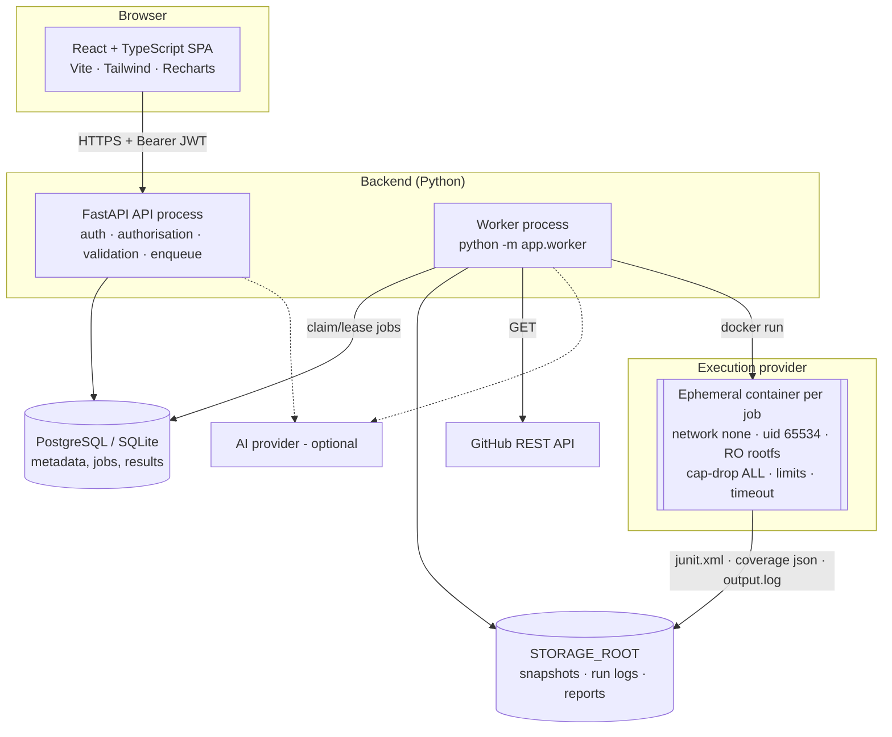

# Architecture

## Components

| Layer | Location | Responsibility |
|---|---|---|
| Frontend | `frontend/src` | `pages/` (one per sidebar item + run detail/compare), `components/ui.tsx` (design system), `layouts/AppLayout.tsx`, `hooks/` (auth/project context, async + polling), `services/api.ts` (typed fetch client), `types/api.ts` |
| API | `backend/app/api` | routers: `auth`, `github`, `projects` (+jobs), `quality` (analysis, findings, generation, review), `runs` (execution, results, compare, coverage), `collab` (bugs, assistant, reports), `analytics`; `deps.py` (auth, authorisation, pagination, rate limiting) |
| Core | `backend/app/core` | `config.py` (pydantic-settings), `security.py` (bcrypt, JWT, Fernet), `logging.py` (secret redaction) |
| Models | `backend/app/models/entities.py` | 18 SQLAlchemy models; Alembic migration `alembic/versions/0001_initial_schema.py` |
| Analysis | `backend/app/analysis` | `repository.py` (scan + structure), `static_python.py` (AST rules, complexity, Ruff), `static_js.py` (JS/TS rules, export extraction) |
| Generation | `backend/app/generators` | `python_tests.py`, `js_tests.py` (rule-based), `ai_tests.py` (AI proposals + validation) |
| AI | `backend/app/ai` | provider abstraction (`NullProvider`, `AnthropicProvider`), structured-output schemas |
| Execution | `backend/app/execution` | `providers.py` (Disabled / DockerSandbox / LocalTrusted), `results.py` (artefact parsing), `failure_analysis.py` |
| Services | `backend/app/services` | job queue, archive extraction, snapshots/imports, analysis, generation, execution, assistant |
| Reporting | `backend/app/reporting` | HTML (Jinja2, autoescaped) and PDF (ReportLab) |
| Worker | `backend/app/worker.py` | job loop, retries, failure bookkeeping |
| Runner | `execution-runner/` | the sandbox image and `runner.py` (stdlib only) that runs *inside* it |

## Data model (main tables)

`users`, `workspaces`, `workspace_members`, `github_connections` (encrypted token), `projects`, `repository_snapshots` (path to files on disk), `jobs`, `repository_analyses` (summary JSON), `findings` (with fingerprint), `generated_tests`, `test_runs`, `test_results`, `coverage_reports`, `bug_reports`, `conversations`, `conversation_messages`, `reports` (paths to generated files), `activities`. Indexes on foreign keys, status columns and `created_at`. Source code, logs and report files are stored on disk under `STORAGE_ROOT`, not in the database.

## Background processing

* Jobs are rows in `jobs` (`import`, `analysis`, `generation`, `execution`, `report`).
* Claiming uses an atomic conditional `UPDATE … WHERE status='queued'` (works on SQLite and PostgreSQL, safe with several workers).
* A claimed job holds a lease (`JOB_LEASE_SECONDS`); expired leases are re-queued until `max_attempts`, then failed.
* Retries only for transient failures (imports/reports); invalid input (`ValueError`, archive rejections, GitHub 401/403/404) fails immediately with the reason recorded.
* Cancellation: queued jobs are cancelled immediately; running execution jobs set `cancel_requested`, the worker kills the container.
* Status values are only those actually recorded — the UI shows no estimated progress.
* `RUN_WORKER_IN_API=true` runs the same loop in a thread inside the API (single-service hosting). Configuration validation refuses this unless `EXECUTION_PROVIDER=disabled`.

## Security boundaries

1. **Browser ↔ API:** Bearer JWT; CORS restricted to configured origins; every project-scoped route loads the project through `get_project`, which checks workspace membership.
2. **API ↔ repository code:** the API only stores/reads files; analysis parses with `ast`/Ruff (no import/execution).
3. **Worker ↔ sandbox:** the worker copies the snapshot into a per-run directory and starts a container with only that directory and an output directory mounted; no environment variables except `HOME`; no network.
4. **Sandbox → worker:** artefacts are untrusted input — size-capped, DOCTYPE/entities rejected, text truncated.
5. **Secrets:** GitHub tokens Fernet-encrypted; AI keys only in backend env; log redaction filter.

See [EXECUTION_SECURITY.md](EXECUTION_SECURITY.md) and [SECURITY.md](SECURITY.md).

## Extensibility

* **New execution provider:** subclass `ExecutionProvider` (`availability`, `run`) and register it in `get_execution_provider`.
* **New AI provider:** subclass `AIProvider.structured()`; schemas are provider-agnostic Pydantic models.
* **New language:** add extensions in `analysis/repository.py`, an analyser returning `RawFinding`s, a generator returning `Proposal`s, and a runner step in `execution-runner/runner.py`.
