# TestPilot AI — Intelligent Software Testing & QA Agent

**AI-powered software testing platform for repository analysis, automated test generation, test execution, bug detection and quality assurance.**

TestPilot AI imports a codebase (GitHub, archive upload, or a bundled demo), analyses its structure, runs static analysis, proposes automated tests, executes **approved** tests in an isolated Docker sandbox, explains failures, measures coverage and produces QA reports — while keeping a strict line between what was *measured* and what is merely *suggested*.

> **Honesty by design.** A generated test is never shown as passed until it has executed. Coverage is never estimated. Static findings are labelled *definite* or *potential*, never "confirmed bugs". AI output is always labelled as a suggestion and never overwrites raw test output.

**Live demo:** https://testpilot-frontend.onrender.com — register any account and click *Load demo project*. The public instance runs on Render's free tier: test execution is disabled there (no sandbox on Render), the first visit may take ~1 minute while the server wakes, and data resets when it restarts.

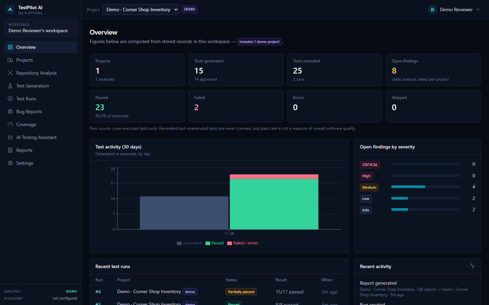

---

## Contents
[Features](#features) · [Screenshots](#screenshots) · [Technology](#technology-stack) · [Architecture](#architecture) · [Quick start](#quick-start) · [Configuration](#configuration) · [GitHub](#github-integration) · [Test execution](#test-execution) · [Demo mode](#demo-mode) · [API](#api-documentation) · [Testing](#testing) · [Security](#security-and-privacy) · [Limitations](#limitations) · [Roadmap](#roadmap) · [Contributing](#contributing) · [Licence](#licence)

## Features

| Feature | Status | Notes |
|---|---|---|
| Registration, login, logout, workspaces | ✅ Implemented & tested | bcrypt hashing, JWT with server-side revocation on logout |
| Projects: manual, public GitHub, archive upload, demo | ✅ Implemented & tested | search, filter, delete, re-import |
| GitHub OAuth for private repositories | 🟡 Implemented, unit-tested with a mocked GitHub API | not tested against a live OAuth app |
| Repository analysis (languages, frameworks, deps, tests, configs, scripts, gaps) | ✅ Implemented & tested | Python, JavaScript, TypeScript |
| Static analysis: Python AST rules, Ruff, JS/TS rules | ✅ Implemented & tested | every finding carries the exact source line as evidence |
| ESLint, `tsc`, mypy | ❌ Not implemented | shown as "not implemented" in the UI; on the roadmap |
| Rule-based test generation (pytest, Vitest) | ✅ Implemented & tested | docstring/JSDoc examples, explicit `raise`/`throw` guards, heuristic edge cases |
| AI test generation, AI failure analysis, AI assistant | 🟡 Implemented, tested with a fake provider | Anthropic Claude via the official SDK; optional |
| Review & approval workflow (edit → re-approval) | ✅ Implemented & tested | approved tests exportable as a zip; repos never modified |
| Isolated execution (Docker sandbox) | ✅ Implemented & tested locally | no network, read-only rootfs, non-root, caps dropped, limits, timeout |
| Results, raw logs, rule-based failure explanations | ✅ Implemented & tested | JUnit XML parsed defensively |
| Coverage (coverage.py, Vitest v8) | ✅ Implemented & tested | line/branch (+function for Vitest); only when measured |
| Bug reports (from findings / failures / manual), export MD/JSON | ✅ Implemented & tested | fields without evidence stay empty |
| Run comparison (regressions, fixes, coverage & findings deltas) | ✅ Implemented & tested | coverage compared only between runs of the same tool |
| PDF & HTML QA reports | ✅ Implemented & tested | sections labelled MEASURED / SUGGESTED / LIMITATION |
| Analytics dashboard | ✅ Implemented | computed from stored records only |
| Render deployment (Blueprint) | ✅ Deployed (free tier) | execution disabled on Render by design; SQLite, data resets on restart |

## Screenshots

All screenshots are genuine captures of the running application (demo project, Docker sandbox enabled, no AI provider), produced by [`scripts/capture-screenshots.mjs`](scripts/capture-screenshots.mjs).

| | |
|---|---|
| **Repository analysis** 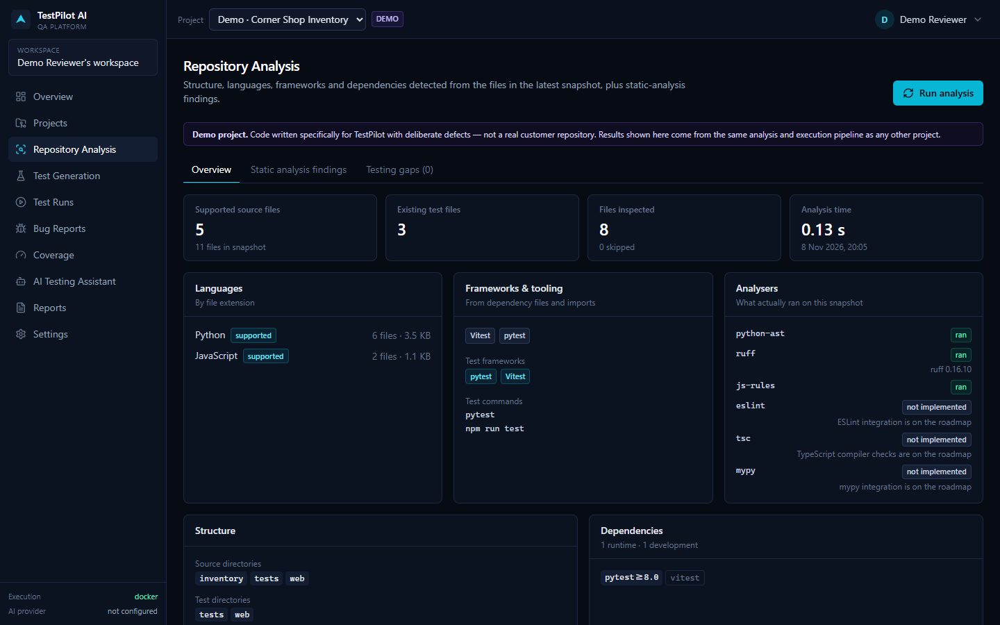 | **Static analysis findings** 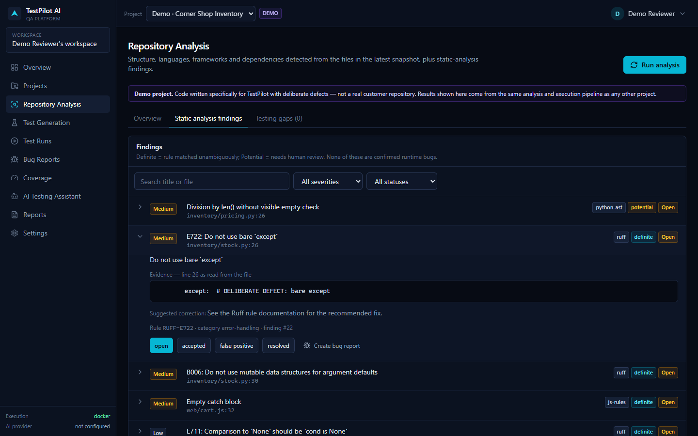 |
| **Test generation & review** 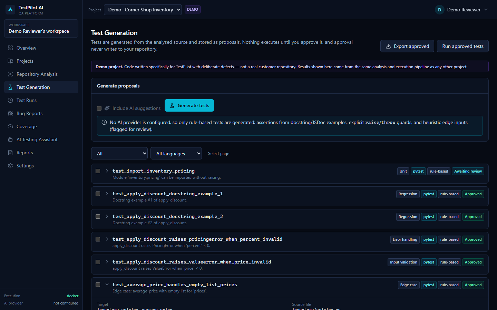 | **Approval → new run** 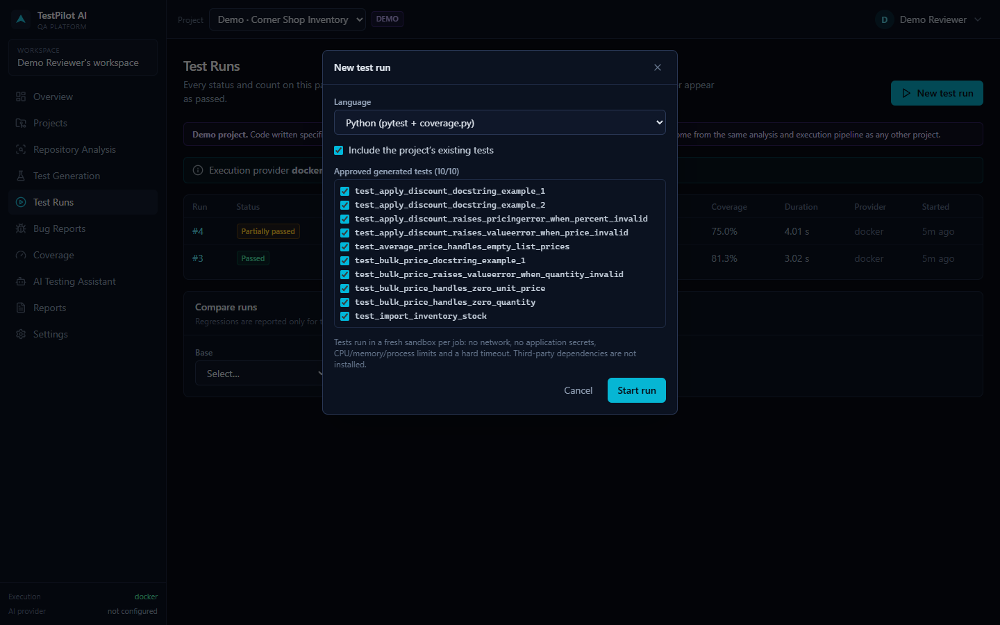 |
| **Test runs** 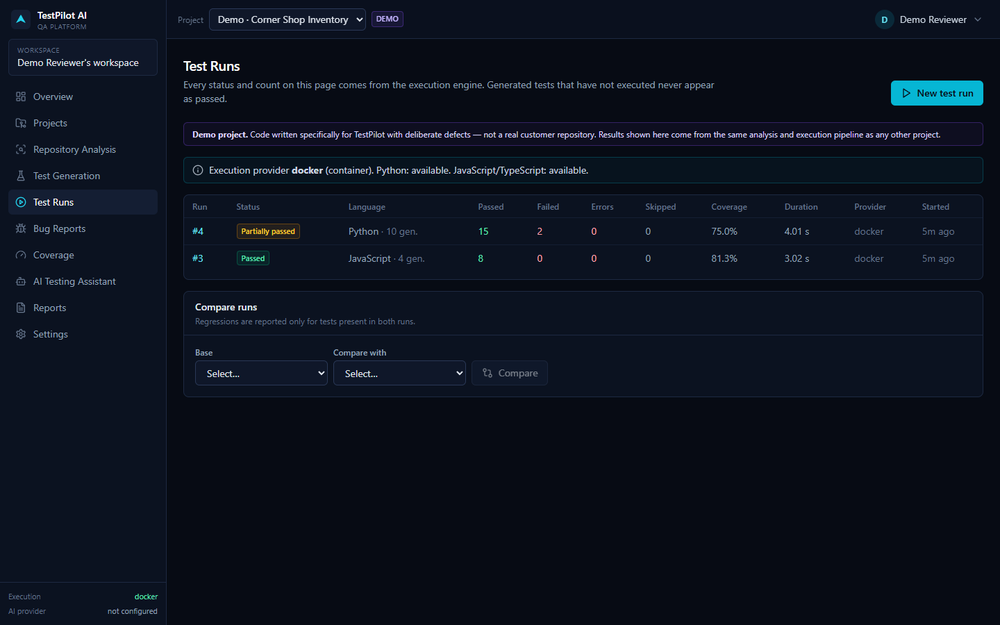 | **Run results** 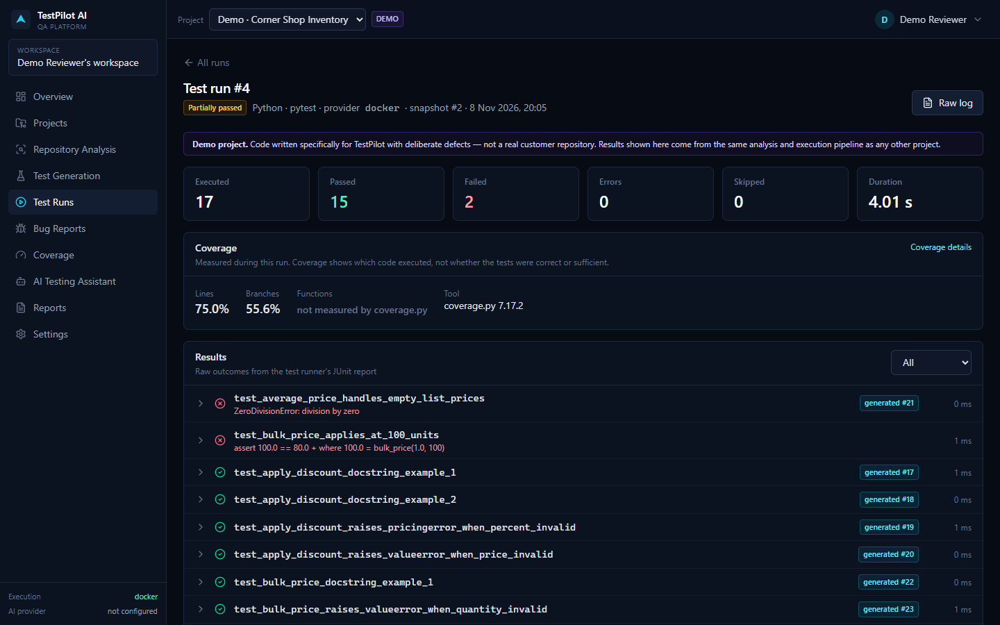 |
| **Failure analysis** 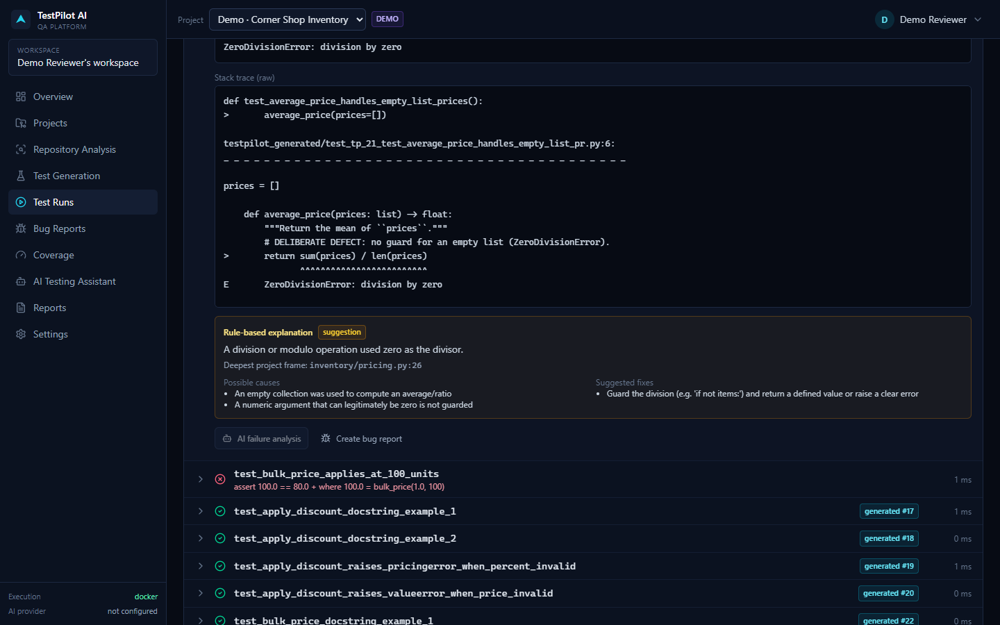 | **Coverage** 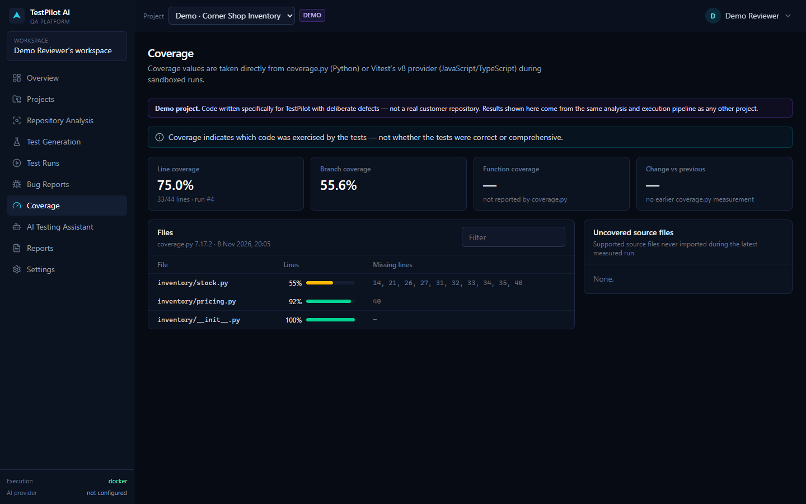 |
| **Bug reports** 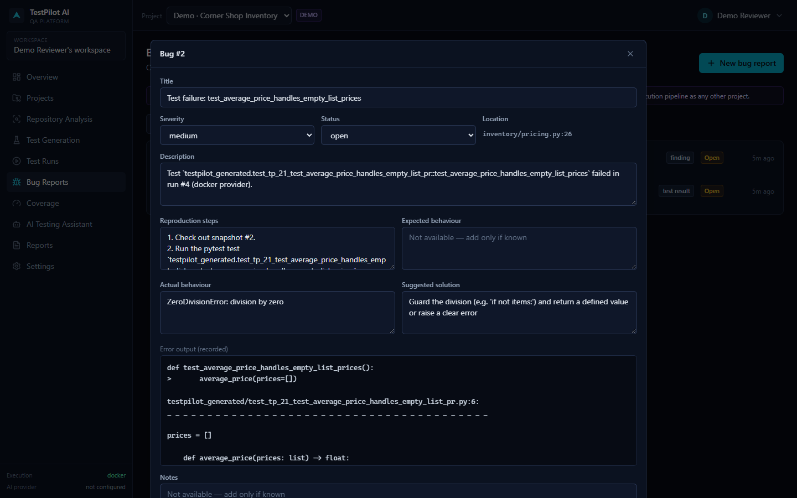 | **Reports** 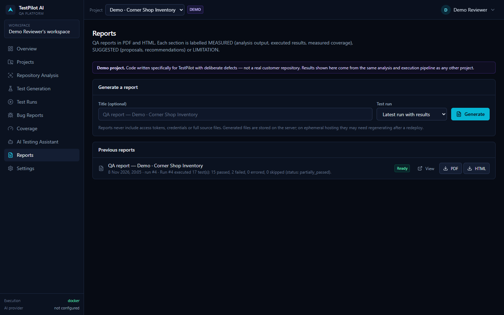 |
| **AI testing assistant (no AI key: grounded mode)** 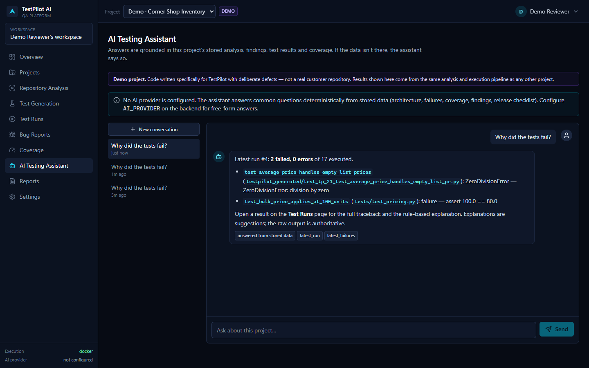 | **Projects** 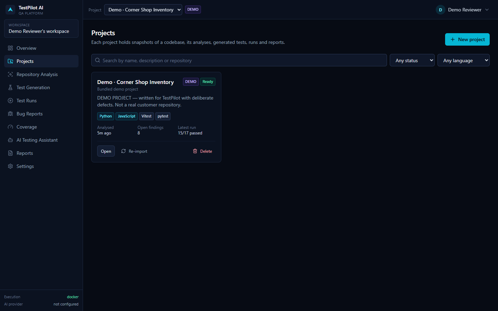 |

## Technology stack

- **Frontend:** React 18, TypeScript 5, Vite 6, Tailwind CSS 4, Recharts, Lucide icons, React Router; Vitest + Testing Library
- **Backend:** Python 3.12, FastAPI, Pydantic v2, SQLAlchemy 2, Alembic, PyJWT, bcrypt, cryptography (Fernet), httpx, ReportLab, Jinja2
- **Analysis:** Python `ast`, Ruff (isolated mode), dependency-free JS/TS rule engine
- **AI (optional):** Anthropic Python SDK (structured outputs validated with Pydantic)
- **Execution sandbox:** Docker image with pytest, coverage.py, Node 22, Vitest 3 + `@vitest/coverage-v8`
- **Database:** SQLite (local default) or PostgreSQL 16 (production; verified)
- **Deployment:** Docker / Docker Compose, Render Blueprint

## Architecture

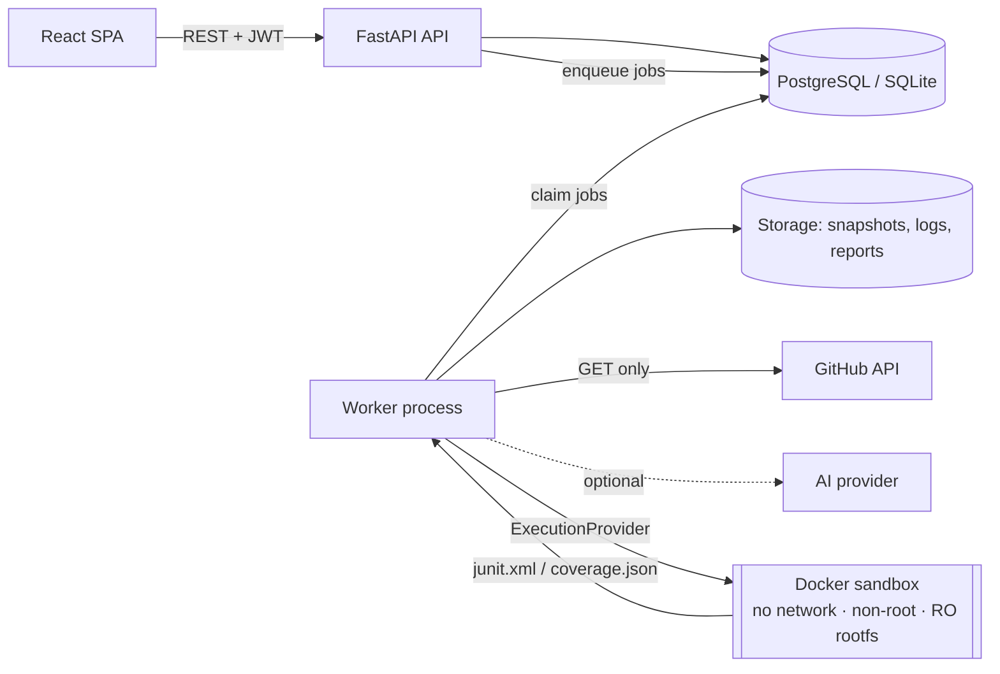

The API never executes repository code. Imports, analysis, generation, execution and report rendering run as jobs in a separate worker; test code runs only inside the execution provider. Details: [ARCHITECTURE.md](ARCHITECTURE.md).

## Quick start

Prerequisites: **Python 3.11+**, **Node.js 20+**; **Docker Desktop** only if you want real test execution.

- **Windows:** double-click **`Start App.bat`**
- **macOS / Linux:** double-click **`Start App.command`** (or `./Start\ App.command`)

The scripts check dependencies, create `.env` from `.env.example` (with a random `SECRET_KEY`), install dependencies on first run, build the sandbox image when `EXECUTION_PROVIDER=docker`, start the API, worker and frontend, and open http://localhost:5173. They never delete data.

Manual setup, Docker Compose and troubleshooting: [INSTRUCTION.md](INSTRUCTION.md).

## Configuration

All variables are documented in [`.env.example`](.env.example). The essentials:

| Variable | Required | Secret | Purpose |
|---|---|---|---|
| `SECRET_KEY` | production | ✅ | JWT signing + token-encryption key derivation (≥32 chars) |
| `DATABASE_URL` | production | ✅ | PostgreSQL URL; empty = local SQLite |
| `FRONTEND_URL`, `CORS_ORIGINS` | production | | exact frontend origin(s); wildcard rejected in production |
| `EXECUTION_PROVIDER` | | | `disabled` (default) · `docker` · `local_trusted` (dev + demo only) |
| `AI_PROVIDER`, `AI_API_KEY`, `AI_MODEL` | optional | ✅ key | `none` (default) or `anthropic` |
| `GITHUB_CLIENT_ID/SECRET/REDIRECT_URI` | optional | ✅ secret | OAuth for private repositories |
| `VITE_API_BASE_URL` | frontend build | public | API URL baked into the SPA — never put secrets in `VITE_` vars |

## GitHub integration

- **Public repositories:** paste `owner/name` or a GitHub URL — no connection needed.
- **Private repositories:** configure an OAuth App (callback `<api>/api/github/oauth/callback`) and connect in **Settings → GitHub**. The `state` parameter is a signed, 10-minute token bound to the user.
- TestPilot only performs **GET** requests (verified by test). Tokens are Fernet-encrypted at rest, never returned by the API and redacted from logs. OAuth Apps cannot request read-only repository scope, so private access uses `repo`; a GitHub App with *Contents: read-only* is on the roadmap.

## Test execution

| Provider | Isolation | Use |
|---|---|---|
| `disabled` (default) | n/a — nothing executes | everywhere, incl. Render |
| `docker` | one short-lived container per job: `--network none`, `--read-only`, `--cap-drop ALL`, `no-new-privileges`, uid 65534, memory/CPU/PID/file limits, tmpfs `/tmp`, hard timeout, only the job workspace mounted, no env secrets | local / self-hosted workers |
| `local_trusted` | **none** — refuses anything except the bundled demo project, Python only, development only | quick local demo without Docker |

Isolation is verified by automated tests that run hostile probes inside the sandbox (secret env vars, network, root FS writes, Docker socket, capabilities, fork bomb, timeout). Docker containers share the host kernel; this is **not** an independently audited sandbox. See [EXECUTION_SECURITY.md](EXECUTION_SECURITY.md).

Limitation: dependencies are **not installed** in the sandbox (network is off). Projects that import third-party packages beyond pytest/coverage/vitest will fail to import — the failure is reported, not hidden.

## Demo mode

Click **Load demo project** on the empty dashboard (or *Projects → New → Demo*). The demo, *Corner Shop Inventory* ([`demo-project/`](demo-project/)), is Python + JavaScript code written specifically for TestPilot with **deliberate defects** (an empty-list `ZeroDivisionError`, an off-by-one bulk-discount boundary, a bare `except`, a mutable default, …). It is labelled **DEMO** throughout the UI and reports, and goes through exactly the same pipeline — including the same sandbox — as any other project. With Docker enabled, its Python run produces 2 real failures and measured coverage.

## API documentation

- Interactive Swagger UI: `http://localhost:8000/api/docs` (ReDoc at `/api/redoc`)
- Endpoint reference: [API_DOCUMENTATION.md](API_DOCUMENTATION.md) · machine-readable: [`docs/openapi.json`](docs/openapi.json)

## Testing

```bash
cd backend && .venv/Scripts/python -m pytest      # Windows (use .venv/bin/python on macOS/Linux)
```

```bash
cd frontend && npm test
```

Latest recorded results (2026-11-08, details in [TESTING.md](TESTING.md)): **backend 83 passed** on SQLite including the 5 Docker-sandbox tests; on PostgreSQL 16 **78 passed, 5 skipped** (sandbox tests skip when Docker is unavailable — they are never reported as passed); **frontend 9 passed**; type-check and production build clean.

## Security and privacy

Summary: bcrypt password hashing; JWT revocation on logout; every endpoint enforces workspace ownership (404 on foreign resources, tested); GitHub tokens encrypted; secrets redacted in logs; archive extraction hardened against zip-slip, links and decompression bombs; JUnit artefacts parsed with DOCTYPE/entity rejection and size caps; rate limiting on auth and AI endpoints; security headers; production refuses weak `SECRET_KEY`, wildcard CORS and `local_trusted`. Full details: [SECURITY.md](SECURITY.md) · [EXECUTION_SECURITY.md](EXECUTION_SECURITY.md).

## Limitations

- No dependency installation inside the sandbox; no Playwright/E2E execution.
- JS/TS static analysis is heuristic (line rules after stripping strings/comments); ESLint/tsc/mypy not integrated.
- Rule-based generation covers module-level Python functions and exported ESM JS/TS functions; class methods and CommonJS exports are not targeted (AI generation can propose them).
- Coverage: coverage.py reports no function coverage; values only exist for executed runs.
- Testing-gap detection is a name-based heuristic (labelled as such).
- Rate limiting is in-memory (per API process).
- Storage is local disk; on Render free tier it is ephemeral (reports/logs may disappear after redeploys — regenerate).
- Docker isolation is container-level, not VM-level; not independently audited.
- Live GitHub OAuth and live AI calls were **not** tested.

## Roadmap

ESLint/`tsc`/mypy integration · GitHub App with read-only contents permission · sandboxed dependency installation stage (allow-listed registry mirror) · gVisor/Firecracker execution provider · object storage for artefacts · Redis-backed rate limiting · Playwright E2E runs · more languages via the analyser/generator plug-in points.

## Contributing

See [CONTRIBUTING.md](CONTRIBUTING.md). Please report vulnerabilities privately as described in [SECURITY.md](SECURITY.md).

## Licence

[MIT](LICENSE). Third-party dependencies keep their own licences (all permissive — MIT/BSD/Apache-2.0/ISC — except psycopg, LGPL-3.0, used as an unmodified dynamically-imported library). See [LICENSE](LICENSE) notes.
